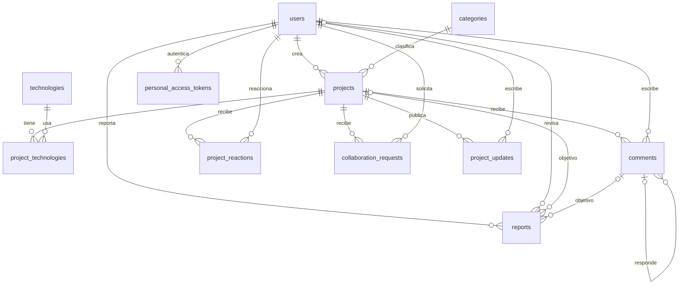

# Base de datos

PostgreSQL 17. Las migraciones son la fuente del esquema; no mantener un dump SQL paralelo. Se conservan las migraciones estándar de usuarios, caché y colas de Laravel, la publicada por Sanctum y las auxiliares publicadas por Fortify. Las funciones 2FA/passkeys están desactivadas.

La relación de tokens es polimórfica de Sanctum, no una FK manual. Los tokens se almacenan hasheados por el paquete.

## Restricciones

- Email único y normalizado en registro; PostgreSQL también tiene índice único sobre `lower(email)`.
- `role`: student/moderator/admin. Nunca se asigna desde registros públicos.
- Categorías y tecnologías: slug único. Proyectos: slug único con ULID.
- Pivote: clave primaria `(project_id, technology_id)`.
- Reacciones: único `(project_id, user_id, type)`, tipo permitido `like`.
- Solicitudes: único `(project_id, user_id)`; reenviar después de rejected/cancelled actualiza la misma fila. Las transiciones usan transacción y bloqueo.
- Reportes: CHECK de PostgreSQL exige exactamente un objetivo. Índices únicos por reportante/proyecto y reportante/comentario impiden repetición, incluso si el reporte ya fue revisado.
- Estados y roles usan restricciones enum/check generadas por Laravel. Las FK tienen índices para consultas y borrado; proyectos tienen índice por estado/fecha.
- Búsqueda inicial por título/resumen con LIKE case-insensitive. No es búsqueda full-text y puede requerir índices trigram si el catálogo crece.

## Borrado

La API archiva proyectos. Borrado físico administrativo de proyecto, si se ejecuta deliberadamente fuera de la API, elimina por cascada pivote, comentarios, reacciones, solicitudes, avances y reportes relacionados. Borrar comentarios elimina sus respuestas y reportes. Usuarios con contenido y catálogos en uso tienen `RESTRICT`; no se ofrece eliminación de cuentas en este MVP. No usar `migrate:fresh` sobre una base compartida.

## Cambios en equipo

Agregar una migración nueva por cambio una vez compartida esta base. No editar migraciones ya aplicadas en entornos de otros compañeros. Ejecutar `php artisan migrate` al actualizar. Seeders solo crean catálogos faltantes: son repetibles y no crean usuarios o administradores con contraseñas conocidas. Los roles elevados se asignan por un administrador mediante un procedimiento operativo, nunca por endpoint público.

SQLite sirve para pruebas rápidas; el CHECK de objetivo de reportes y el índice case-insensitive adicional se comprueban en PostgreSQL. La suite PostgreSQL usa exclusivamente la base `incubadora_test`, forzada en `phpunit.pgsql.xml`.
